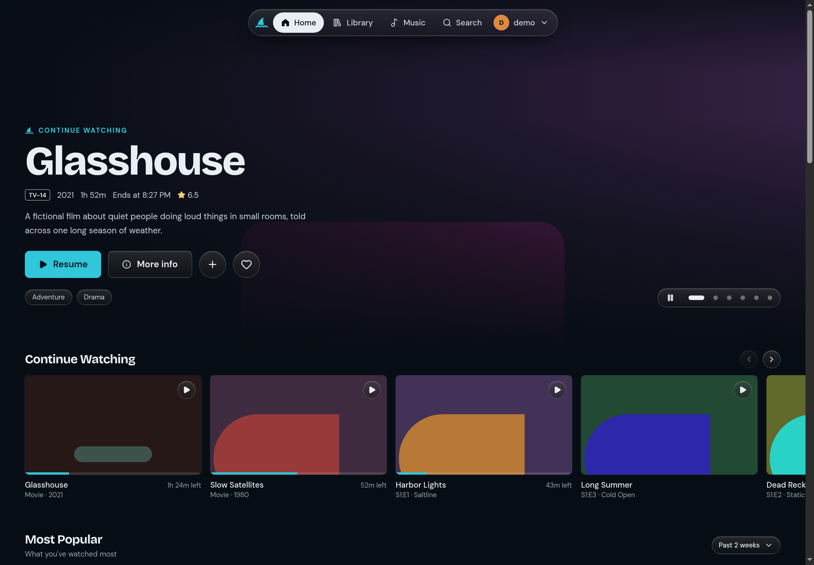
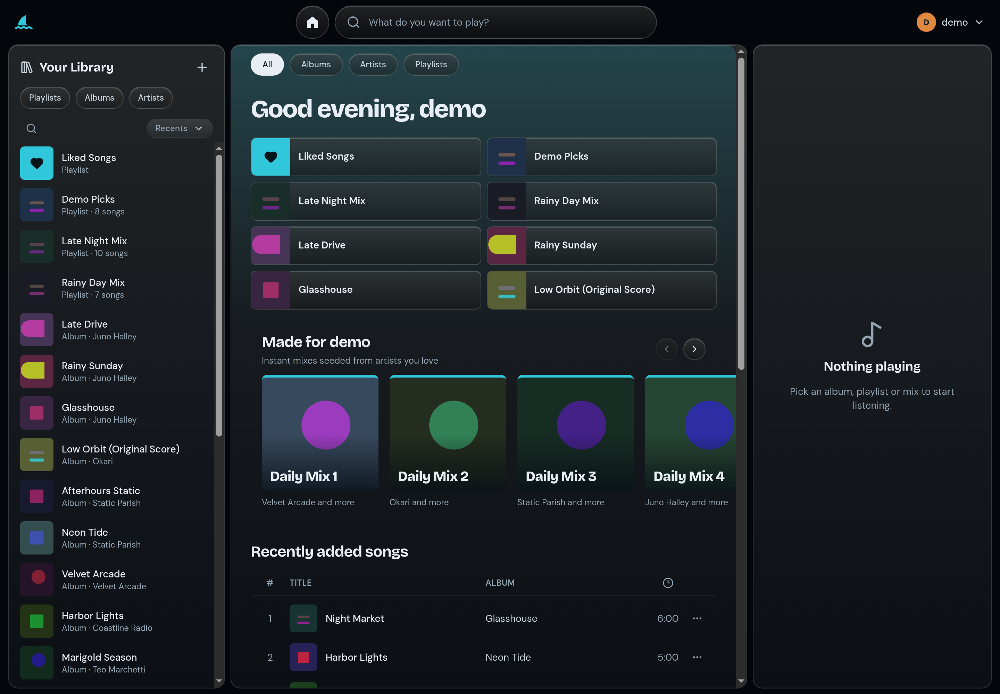

# Jelly Shark

A custom web frontend for [Jellyfin](https://jellyfin.org): movies, TV, music with synced lyrics, and search, in one app.

> **Beta.** Jelly Shark works day to day, but the phone layout is still being finished and things will change.
> Expect rough edges, and please [open an issue](https://github.com/HeavyLvy/jelly-shark/issues) when something breaks.
> The beta lives on the `beta` branch.

Jelly Shark runs as a small server next to your Jellyfin. Your browser only talks to Jelly Shark, and Jelly Shark talks
to Jellyfin, so the browser never sees a Jellyfin access token (sign-ins are kept in an encrypted, httpOnly cookie).
It doesn't replace Jellyfin or change your library. It's another way to use the server you already have.

## Screenshots





> **About these images:** everything shown is placeholder data. The titles, artists, albums and artwork are made up
> and generated by [`scripts/mock-jellyfin.mjs`](scripts/mock-jellyfin.mjs), a small fake Jellyfin server used only
> for screenshots and development. No real movies, shows or music, and no copyrighted material, appear in them. In
> your own install, all content comes from your own Jellyfin server.

## Features

- **Movies and TV:** a home page with what you're watching, new episodes and new additions; library browsing with
  filters and A–Z; show pages with seasons and episodes; cast, trailers, extras and media info.
- **Video player:** direct play or transcoding, audio and subtitle tracks, subtitle styling and timing, chapters,
  seek previews (trickplay), playback speed, Skip Intro (when your server has media segments), next-episode countdown.
- **Music:** a Spotify-style music section with albums, artists, playlists, Liked Songs, queue, radio, a sleep timer
  and synced lyrics (including an expanded mode and a full-screen mode).
- **Search:** finds titles despite typos, spaces or punctuation ("spnge bob" finds *SpongeBob SquarePants*), and
  also finds people, your favorites, and pages and settings in the app.
- **Profiles:** several Jellyfin users can stay signed in on one browser and switch without a password. Quick Connect
  works both ways: sign in with a code, or approve another device from inside Jelly Shark.
- **Phones:** touch-friendly layouts with a bottom tab bar, swipe gestures and a Now Playing screen.
- **For the person running it:** per-user settings saved on the server, custom branding (name, icon, accent color), and
  control over whether people may connect to other Jellyfin servers.

## Requirements

- A Jellyfin server. Jelly Shark is built and tested against **Jellyfin 12.2**. Older servers may not work.
- **Docker** (recommended), or **Node.js 24** to run it without Docker.
- A machine that can reach your Jellyfin server over the network (it can be the same machine).

## Install with Docker (recommended)

1. Download the code and switch to the beta:

   ```bash
   git clone -b beta https://github.com/HeavyLvy/jelly-shark.git
   cd jelly-shark
   ```

2. Create your settings file:

   ```bash
   cp .env.example .env
   ```

   Open `.env` and set two values:

   - `JELLYFIN_URL`: your Jellyfin server's address as seen *from the Jelly Shark container*, for example
     `http://192.168.1.10:8096`. Use the machine's LAN IP, not `localhost` (inside a container, `localhost` is the
     container itself).
   - `SESSION_SECRET`: a long random string that encrypts sign-in cookies. Generate one with
     `openssl rand -base64 48`. Keep it private; changing it signs everyone out.

3. Start it. This downloads the prebuilt image from GitHub's container registry (no build needed):

   ```bash
   docker compose up -d
   ```

4. Open `http://<this machine's IP>:3100` and sign in with your Jellyfin username and password, or with Quick Connect.

If something is wrong with the settings, the container stops right away and its log says what to fix:
`docker compose logs jelly-shark`.

### Updating

```bash
git pull
docker compose pull
docker compose up -d
```

Your settings and branding are kept in the `jelly-shark-data` Docker volume, so they survive updates. Database
changes are applied automatically when the new version starts.

### Which image tag

The image is `ghcr.io/heavylvy/jelly-shark`, built for `amd64` and `arm64`. `docker-compose.yml` uses the `beta` tag, the
newest beta. For a setup that never changes under you, pin an exact version such as `0.1.0-beta.1` instead. There is no
`latest` tag until the first stable release. Tags and version numbers are explained in [RELEASING.md](RELEASING.md).

### Without Compose

```bash
docker run -d --name jelly-shark -p 3100:3000 \
  -e JELLYFIN_URL=http://192.168.1.10:8096 \
  -e SESSION_SECRET="$(openssl rand -base64 48)" \
  -v jelly-shark-data:/data \
  ghcr.io/heavylvy/jelly-shark:beta
```

(Generate the secret once and reuse it. A new secret on every start signs everyone out.)

### Build the image yourself

You only need this to try your own changes or to set a custom poster size (`NEXT_PUBLIC_POSTER_WIDTH`, which is fixed
at build time, so the prebuilt image always uses the default of 215). With the repository cloned and `.env` filled in:

```bash
docker compose up -d --build
```

Or without Compose: `docker build -t jelly-shark .`, then the `docker run` command above with `jelly-shark` as the last
line instead of the `ghcr.io/...` image.

## Install without Docker

Needs Node.js 24.

```bash
git clone -b beta https://github.com/HeavyLvy/jelly-shark.git
cd jelly-shark
cp .env.example .env.local     # set JELLYFIN_URL and SESSION_SECRET as above
npm ci
npm run build
npm start
```

Then open `http://<this machine's IP>:3000`. Set `PORT` to use a different port (`PORT=3100 npm start`). Settings are
saved in `./data/jelly-shark.db` (change it with `DATABASE_PATH`). To update, `git pull`, then `npm ci`,
`npm run build` and `npm start` again. For a long-running install, run it under a process manager such as systemd or pm2.

## Configuration

All configuration is through environment variables (`.env` for Docker Compose, `.env.local` without Docker).

| Variable | Required | What it does |
| --- | --- | --- |
| `JELLYFIN_URL` | Yes | Default Jellyfin server address, no trailing slash. An administrator can change it later in Settings. |
| `SESSION_SECRET` | Yes | 32+ random characters used to encrypt sign-in cookies. |
| `NEXT_PUBLIC_POSTER_WIDTH` | No | Poster width in pixels, 120–400 (default 215). Fixed when the image is built, so it only applies if you [build the image yourself](#build-the-image-yourself); the prebuilt image uses 215. |
| `DATABASE_PATH` | No | Where the settings database lives. Default `./data/jelly-shark.db`; the container uses `/data/jelly-shark.db`. |

### HTTPS and reverse proxies

Jelly Shark serves plain HTTP. To use HTTPS or a domain name, put it behind a reverse proxy (Caddy, nginx, Traefik…)
pointing at port 3100. Forward the `Host` header (and `X-Forwarded-Host` if your proxy changes it): Jelly Shark checks
that changes come from its own address, and requests with a mismatched origin are refused.

## Using it

- **Sign in** with any Jellyfin account. Jellyfin's own permissions apply: people only see the libraries their account
  can see.
- **Profiles:** use the account menu (your avatar, top right) to add another profile or switch between them.
- **Approve a device:** in the account menu, choose *Approve a device* and type the 6-digit Quick Connect code shown
  on the other device (a TV app, another browser). Quick Connect must be turned on in Jellyfin's dashboard.
- **Keyboard shortcuts:** *Shortcuts & gestures* in the account menu lists them. Space plays or pauses, and the arrow
  keys seek and change volume.
- **Settings** (playback quality, languages, subtitle style, poster size, which rows Home shows) are saved per user on
  the server, so they follow you to other devices.

### For administrators

Jellyfin administrators get extra sections in Settings:

- **Server:** change the default Jellyfin address (it's checked before saving), and choose who may pick a server:
  - **Locked** (default): everyone uses your server and never sees server options. Good for a family setup.
  - **Users can choose:** the sign-in screen gets *Change server*, and each profile remembers the server it signed in to.
- **Branding:** change the app's name, icon (built-in presets, or upload your own and crop it) and accent color for
  everyone, including the sign-in page. *Reset to defaults* restores the original look.

Only administrators of the server set in `JELLYFIN_URL` count as administrators here.

## Tips and troubleshooting

- **No seek-bar previews:** turn on trickplay in Jellyfin (Dashboard → Libraries → trickplay image extraction), then
  run the *Generate Trickplay Images* task.
- **No Skip Intro button:** Jellyfin needs media segments, which come from an intro-detection plugin.
- **"Can't reach the server" at sign-in:** check that `JELLYFIN_URL` opens from the machine running Jelly Shark
  (for Docker, from inside the container: `docker compose exec jelly-shark wget -qO- $JELLYFIN_URL/System/Info/Public`).
- **Signed out after an update:** that happens if `SESSION_SECRET` changed. Keep it the same across updates.
- **Health check:** `GET /api/health` returns `{"ok":true}`. The Docker image already uses it.

## Development

```bash
cp .env.example .env.local
npm install
npm run dev        # http://localhost:3100, also reachable from other devices on your network
```

Built with Next.js 16, React 19, Tailwind CSS 4, TanStack Query and the official
[`@jellyfin/sdk`](https://github.com/jellyfin/jellyfin-sdk-typescript). The app's own data (settings, branding) is in
SQLite through [Drizzle ORM](https://orm.drizzle.team): the schema is in `lib/db/schema.ts`; after changing it run
`npm run db:generate` and commit the new migration in `drizzle/`. Migrations run automatically at startup.

No Jellyfin server handy? `npm run mock:jellyfin` starts a fake one on port 8920 with made-up movies, shows and music.
Set `JELLYFIN_URL=http://127.0.0.1:8920` and sign in with any username and password.

Before sending a change, run `npx next typegen && npx tsc --noEmit` (the first part generates Next's route types, which a
fresh clone doesn't have yet), `npm run lint`, `npm run build`, `npm test` (fast unit tests) and `npm run test:e2e` (browser tests at desktop and
phone size against the built-in mock Jellyfin; build first, and run `npx playwright install chromium` once). Versioning and how releases are
made are in [RELEASING.md](RELEASING.md).

## Reporting problems and contributing

Bugs, ideas and questions go in [issues](https://github.com/HeavyLvy/jelly-shark/issues/new/choose); how they are
handled, and what a good pull request looks like, is in [CONTRIBUTING.md](CONTRIBUTING.md). Security problems must be
reported privately: see [SECURITY.md](SECURITY.md).

## License

Apache License 2.0. See [LICENSE](LICENSE) and [NOTICE](NOTICE), which also lists third-party attributions.
Jelly Shark is an independent project and is not affiliated with or endorsed by the Jellyfin project.
