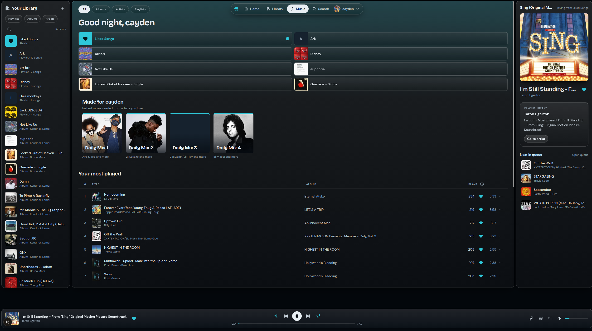
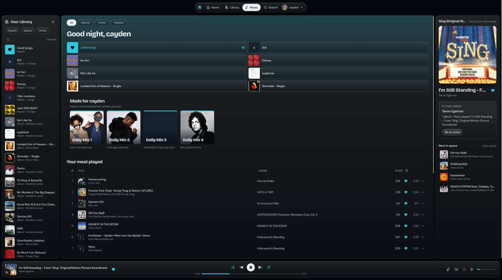

# Music

- add keyboard control's, left arrow, right arrow, space. Add proper media control,s i notice that previous and next track buttons work, but pause/play does not.
- When hovering over the time bar, add a mouse popup that display the time being selected.
- A button to stop playing music.
- Grey out the lyrics button if no lyrics are available.
- Put the lyrics in the middle of the screen, the current spokn lyric shoudl be highligthed, and shoudl move the scroll of the lyrics, if the user maunly moves the lyrics scroll, it shoudl stop auto scrolling, if the user then goes back to the highlighted lyric when its near the screen or if the user maunly clicks on it, auto scrolling shoudl be turned back on. the lyrics should be put in the center and be around 2-3x wider than what it already is.
- In the album/playlist overview on the right, where it shows the time, the time icon is over the "liked/hearted" button instead of the actull time. Also it apperas to allighted to the right of the hearts instead of the center, make sure that doesnt happen when its put over the time.
- Im able to scroll in the music page, like have the whole page scroll, which its not how its supposed to be. (The music player at the bottom and the nav bar at the top stick)
- There is empty space when the nav bar is fully at the top, the nav bar shoudl be intergrated into the music page: look at fix1.png and fix2.png, you can also see in fix1.png you can see that you can scroll. and it takes you to the empty space.

- Sometimes when going in and out of full screen or when pessing one of the F row keys it like stops/pauses the song for like a very split second. Pressin gwindows key does it too.
- Add right click menus
- When skipping songs with kde's music controll it liek losses access to contorll it, it doesnt do then when skipping to the previous song (could be kde specific issue, but doesnt happen with other players, worth invetsting)
- The repeat button in kde's media controller doesnt sync with the web app (at least visualy)
- When clicking on the blank space of a song in the album overview, it should play it just like a the play button